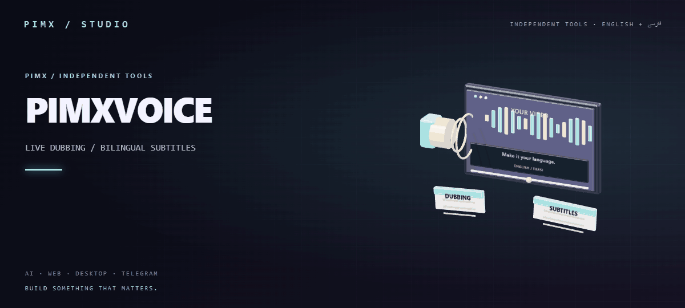

<div align="center">


**[English](README.md) · [فارسی](README.fa.md)**

**[دانلود نسخهٔ ۲.۲](https://github.com/MOHAMMADREZAABEDINPOOR/PIMX_VOICE/releases/latest) · [پورتفولیو](https://pimx.pages.dev/project)**
</div>

# PIMXVOICE 2.2

افزونهٔ Chrome و Edge برای **دوبله، زیرنویس یا هردو** با Gemini. رابط فارسی و انگلیسی، تم روشن و تیره، و کنترل کامل داخل popup نوار ابزار.

زبان پیش‌فرض نصب تازه انگلیسی است؛ دکمهٔ زبان در بالای پنجره، رابط را فارسی می‌کند. زبان انتخاب‌شدهٔ قبلی هنگام به‌روزرسانی حفظ می‌شود.

## نصب یا به‌روزرسانی

1. فایل `pimxvoice-2.2.0.zip` را استخراج کنید.
2. در `chrome://extensions` یا `edge://extensions`، **Developer mode** را روشن کنید.
3. **Load unpacked** را بزنید و پوشهٔ دارای `manifest.json` را انتخاب کنید. اگر نسخهٔ قبلی از همین پوشه نصب شده، دکمهٔ Reload افزونه را بزنید و صفحهٔ ویدیو را تازه‌سازی کنید.
4. آیکن PIMXVOICE را Pin کنید. میان‌بر بازکردن: **Alt+Shift+L**؛ از بخش keyboard shortcuts مرورگر قابل تغییر است.
5. در [Google AI Studio → API keys](https://aistudio.google.com/apikey) وارد حساب شوید، **Create API key** را بزنید و پروژه را بسازید یا انتخاب کنید. کلید را داخل افزونه وارد کنید و **اتصال و بررسی مدل‌ها** را بزنید.
6. ویدیو را پخش کنید، خروجی و زبان‌ها را تنظیم کنید و شروع را بزنید. بستن popup ترجمه را متوقف نمی‌کند؛ از دکمهٔ توقف داخل popup یا روی صفحه استفاده کنید.

Chrome/Edge نسخهٔ ۱۱۶ یا جدیدتر لازم است. افزونه برای Firefox ساخته نشده است.

## حالت خروجی و صدای دوبلور

در بخش «ترجمه» یکی را انتخاب کنید:

- **فقط دوبله:** صدای ترجمه پخش می‌شود؛ زیرنویس روی صفحه نمایش داده نمی‌شود.
- **فقط زیرنویس:** متن یک یا دو زبان نمایش داده می‌شود؛ صدای ترجمه پخش نمی‌شود و صدای اصلی کامل می‌ماند.
- **هردو:** دوبله و زیرنویس همزمان فعال‌اند.

زبان دوبله مستقل از زبان زیرنویس است. فهرست صدای دوبلور شامل پیش‌فرض مدل و ۳۰ صدای آمادهٔ Gemini از جمله Puck، Kore، Charon و Aoede است. در حالت پیش‌فرض، مدل‌های صوتی صدای خود را می‌دهند؛ در مسیر Transcribe، صدای پیش‌فرض Kore است. با انتخاب صدای مشخص، متن ترجمه با مدل گفتارساز انتخابی تولید و پخش می‌شود.

هنگام پخش دوبله، صدای اصلی به ۲۲٪ کاهش می‌یابد و بعد از تمام‌شدن دوبله برمی‌گردد. پخش صوت WAV و PCM پشتیبانی می‌شود. انتخاب صدا، تولید صدا با لحن آماده است؛ تقلید یا شبیه‌سازی صدای اشخاص نیست.

## زبان‌ها و ظاهر زیرنویس

در تب «زیرنویس» زبان اول را انتخاب کنید. با روشن‌کردن **زیرنویس دوزبانه**، زبان دوم جداگانه انتخاب می‌شود؛ گزینهٔ «زبان اصلی گفتار» هم برای خط دوم وجود دارد. مثلاً دوبلهٔ فارسی و زیرنویس انگلیسی/فرانسوی ممکن است.

تنظیمات ظاهری:

- آپلود فونت TTF، OTF، WOFF و WOFF2 تا ۲ مگابایت؛ فایل فقط روی همان دستگاه می‌ماند.
- اندازهٔ مستقل دو خط از ۱۲ تا ۷۲ پیکسل؛ رنگ مستقل هر خط.
- رنگ و میزان تیرگی پس‌زمینه، رنگ و ضخامت دورخط، سایه و وزن نوشته.
- بالا/پایین، فاصله از لبه، تراز، فاصلهٔ خطوط، گردی گوشه و حاشیهٔ داخلی.
- پیش‌نمایش ظاهر و بازنشانی تنظیمات. تنظیمات ظاهر هنگام ترجمه هم قابل تغییرند.

برای تغییر زبان، مدل، صدای دوبلور یا حالت خروجی ابتدا توقف را بزنید. فونت و ظاهر بدون توقف روی ویدیو اعمال می‌شوند. پیش‌نمایش اصلی popup کوچک‌شده است؛ پیش‌نمایش تب زیرنویس و خروجی روی ویدیو، اندازهٔ انتخابی را استفاده می‌کنند.

## چند کلید API و جابه‌جایی خودکار

در تب «کلیدهای API» می‌توانید تا ۱۲ کلید اضافه کنید، نام بدهید، اولویت را تغییر دهید یا کلید را حذف کنید. فقط نام و چهار کاراکتر آخر نمایش داده می‌شود. نگهداری کلید برای هر ورودی جدا انتخاب می‌شود:

فرم «افزودن کلید دیگر» از ابتدا باز است؛ نام و کلید جدید را وارد کنید و دکمهٔ افزودن را بزنید. کلیدهای قبلی باقی می‌مانند. برای افزودن یا حذف کلید، ترجمه باید متوقف باشد.

- پیش‌فرض: `chrome.storage.session`، تا پایان نشست مرورگر.
- «روی این دستگاه بماند»: `chrome.storage.local`، بدون همگام‌سازی و **بدون رمزگذاری**.

اگر WebSocket یا درخواست ترجمه/گفتارسازی خطای سهمیهٔ 429 یا ردشدن کلید بدهد، کلید بعدی امتحان می‌شود. درخواست متنی/صوتی ناموفق دوباره اجرا و استریم با کلید جدید متصل می‌شود؛ ترک ضبط صدا حفظ می‌شود. کلیدی که در همان جلسه تمام شده دوباره امتحان نمی‌شود. اگر همهٔ کلیدها نامعتبر یا بدون سهمیه باشند، ضبط متوقف می‌شود و پیام راهنما دیده می‌شود.

**کلیدهای یک پروژهٔ Google ممکن است سهمیهٔ مشترک داشته باشند. افزودن کلید از همان پروژه، سقف مصرف را افزایش نمی‌دهد.** هنگام اتصال مجدد ممکن است بخشی از گفتار از دست برود؛ این قابلیت تضمین پخش بدون وقفه نیست. [مصرف و سهمیه در AI Studio](https://aistudio.google.com/rate-limit).

## مدل‌ها، مصرف و تأخیر

مدل‌های قابل‌انتخاب بعد از اتصال کلید معتبر، از API خود کاربر و قابلیت `bidiGenerateContent` دریافت می‌شوند. انتخاب «مدل زنده» همیشه در تب ترجمه دیده می‌شود؛ مدل متنی و گفتارساز در تنظیمات پیشرفته قرار دارند. اگر فهرست ذخیره‌شده موجود نباشد، هنگام بازکردن popup دوباره دریافت می‌شود. دکمهٔ «تازه‌سازی» هم فهرست را به‌روز می‌کند؛ خطای شبکه فهرست قبلی را پاک نمی‌کند. فهرست‌شدن مدل، تضمین سهمیه یا مجوز همهٔ قابلیت‌های آن نیست.

تمام فهرست‌های کشویی ظاهر سفارشی و جست‌وجو دارند. برای زبان‌ها می‌توانید نام فارسی، انگلیسی یا کد زبان را جست‌وجو کنید. کلیدهای جهت‌دار برای حرکت، Enter برای انتخاب و Escape برای بستن فهرست هستند. عرض popup روی ۴۲۰ پیکسل تثبیت شده تا فرم اتصال در پنجرهٔ نوار ابزار بریده نشود.

| مسیر | رفتار |
| --- | --- |
| Gemini Live Translate | صدای پیش‌فرض و ترجمهٔ پیوستهٔ همان زبان؛ زبان مبدأ خودکار |
| Gemini Native Audio / Live | مترجم صوتی؛ خروجی ممکن است به مکث گفتار وابسته باشد |
| Gemini Transcribe Live | رونویسی → ترجمهٔ مستقل زبان‌ها → صدای آمادهٔ انتخابی |

مدل‌های فقط فایل مانند `gemini-3.5-transcribe` مدل استریم نیستند و انتخاب نمی‌شوند. پیش‌فرض ترجمهٔ متن `gemini-3.5-flash-lite` و گفتارساز `gemini-3.8-flash-lite-tts` است؛ هر دو در تنظیمات مدل قابل تغییرند.

صدای سفارشی، زبان زیرنویس متفاوت با دوبله یا خط ترجمهٔ دوم ممکن است درخواست‌های اضافی متن و صدا داشته باشند. درخواست ترجمه برای زبان‌های مشترک تکرار نمی‌شود؛ زبان مبدأ مشخص هم می‌تواند مستقیم برای زیرنویس استفاده شود. مدل‌های صوتی Live در حالت فقط زیرنویس، همچنان در سمت Google صوت تولید می‌کنند و افزونه فقط آن را پخش نمی‌کند. برای حذف تولید صوت در API از Transcribe Live استفاده کنید.

گفتار پیوسته در مسیر رونویسی با مرزبندی فعالیت و قطعات متنی کوتاه پردازش می‌شود. ترجمهٔ متن و تولید صدا صف‌های جدا و محدود دارند. دوبلهٔ آماده ممکن است از صدای اصلی عقب‌تر باشد؛ تأخیر به مدل، طول گفتار و شبکه وابسته است. پشتیبانی زبان‌ها، کیفیت و هزینه تابع مدل و پروژهٔ Google است؛ پشتیبانی از تمام زبان‌های جهان یا تأخیر صفر تضمین نمی‌شود.

## حریم خصوصی و محدودیت‌ها

هیچ کلید API در کد، لوگو یا بسته قرار ندارد. فقط صدای تب انتخاب‌شده بعد از شروع به Google می‌رود؛ میکروفون، تصویر و محتوای صفحه خوانده نمی‌شوند. content script به مخزن کلیدها دسترسی ندارد. پردازش Google تابع [شرایط Gemini API](https://ai.google.dev/gemini-api/terms) است.

رفتـن به صفحهٔ دیگر، بستن تب یا توقف، ضبط را پایان می‌دهد. هنگام توقف ترک‌ها، AudioContext، WebSocket، درخواست‌های شبکه و صف‌های صوتی آزاد یا لغو می‌شوند. ۸۰ بخش آخر متن تا پایان نشست مرورگر نگه داشته می‌شود و با «ذخیرهٔ متن» قابل دانلود است.

صفحات داخلی مرورگر، فروشگاه افزونه و بعضی محتوای DRM قابل ضبط نیستند. در iframeها ممکن است زیرنویس در پایین سند اصلی نمایش داده شود. تمام‌صفحهٔ container پلیر پشتیبانی می‌شود؛ تمام‌صفحهٔ بومی خود عنصر ویدیو، Picture-in-Picture و iframeهای cross-origin ممکن است زیرنویس HTML را نشان ندهند. در این حالت از حالت سینمایی استفاده کنید.

## توسعه و تست

برای نصب به build یا npm install نیاز نیست. فایل‌های اصلی HTML/CSS/JavaScript بدون وابستگی زمان اجرا هستند.

```powershell
npm test
npm run check
npm run package
```

بسته‌بندی به Python نیاز دارد و فقط فایل‌های اجرا، لوگو، فونت، آیکن‌ها و راهنماهای فارسی و انگلیسی را به `dist/pimxvoice-2.2.0.zip` می‌برد؛ تست‌ها، پروفایل مرورگر و فایل‌های صوتی آزمایشی بسته‌بندی نمی‌شوند.

تست UI با Python و Playwright: `python scripts/browser-v2.py`. تست واقعی صدا: کلید را از stdin به `python scripts/browser-v2.py --live` بدهید. کلید را در فایل کد ذخیره نکنید. تست به `artifacts/sample-en.wav` تک‌کانالهٔ PCM16/16kHz نیاز دارد. برای جایگزینی کلیک فیزیکی روی آیکن در حالت headless، کپی موقتی با دسترسی فقط به localhost و allowlist آزمایشی ضبط Chromium ساخته می‌شود؛ manifest اصلی تغییر نمی‌کند. خطای سهمیه و تعویض کلید در تست‌های شبیه‌سازی‌شدهٔ REST و WebSocket بررسی می‌شوند تا سهمیهٔ واقعی عمداً مصرف نشود.

## لوگو و منابع

لوگوی شفاف اصلی: [assets/pimxvoice-logo.png](assets/pimxvoice-logo.png). با ابزار داخلی ImageGen ساخته شده است؛ متن دقیق پرامپت و منشأ در [assets/logo-prompt.txt](assets/logo-prompt.txt) آمده است. آیکن‌های ۱۶، ۳۲، ۴۸ و ۱۲۸ پیکسلی از همان فایل تولید شده‌اند.

- [Gemini Live Translate](https://ai.google.dev/gemini-api/docs/live-api/live-translate)
- [Gemini Live Transcribe](https://ai.google.dev/gemini-api/docs/live-api/live-transcribe)
- [Gemini speech generation و صداها](https://ai.google.dev/gemini-api/docs/speech-generation)
- [Chrome tab audio capture](https://developer.chrome.com/docs/extensions/how-to/web-platform/screen-capture)
- فونت [Vazirmatn](https://github.com/rastikerdar/vazirmatn) با مجوز [SIL OFL](fonts/OFL.txt).
