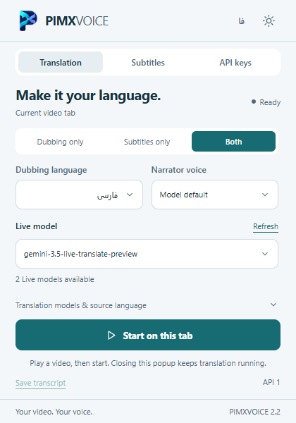
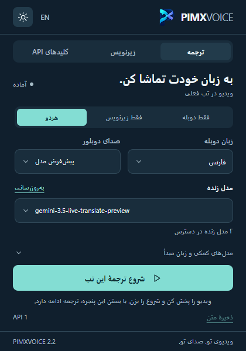
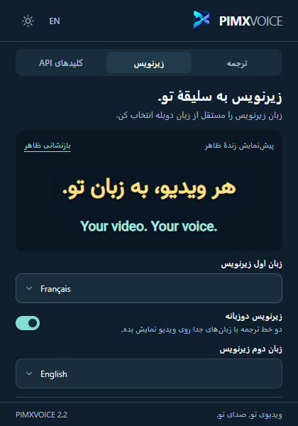
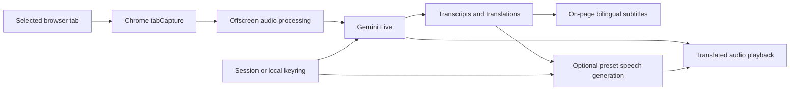

<div align="center">


**[English](README.md) · [فارسی](README.fa.md)**

**[Download v2.2](https://github.com/MOHAMMADREZAABEDINPOOR/PIMX_VOICE/releases/latest) · [Portfolio](https://pimx.pages.dev/project) · [Installation](#install-in-five-steps)**
</div>

# PIMXVOICE

### Make it your language.

Live dubbing and bilingual subtitles for the video playing in your browser. PIMXVOICE captures the selected tab’s audio, sends it to Gemini using your own API key, and brings translated speech and readable captions back to the page.

Choose **dubbing**, **subtitles**, or **both**. Set the narration language independently of the two subtitle languages. Keep watching while the extension works in the background.

| Platform | Engine | Interface | Version |
|:---|:---|:---|:---|
| Chrome / Edge 116+ | Gemini Live + text / speech APIs | English & Persian · light / dark | 2.2.0 · Manifest V3 |

## See the extension

Actual captures of the extension interface. The subtitle preview is sample text; it is not a measured translation benchmark.

| Translation · English | Translation · فارسی | Subtitle styling · فارسی |
|:---:|:---:|:---:|
|  |  |  |

## One tab. Three ways to follow it.

| Output | What happens |
|:---|:---|
| Dubbing only | Play translated speech without an on-page subtitle overlay. |
| Subtitles only | Show one or two text tracks and preserve the original audio volume. |
| Both | Hear the translation and follow the captions together. |

- **Independent language choices.** Narration and subtitle tracks can use different languages; the second line can show the original speech.
- **30 preset narrator voices.** Use the model default or a voice such as Kore, Puck, Charon or Aoede. These are preset voices, not voice cloning.
- **Subtitles that fit your screen.** Upload a local font, set each line’s size and color, then adjust position, outline, background, spacing and alignment. Change appearance while translation is running.
- **A keyring with automatic failover.** Keep up to 12 keys, reorder them, and retry a failed request with the next key when quota or authentication errors occur.
- **Your available models.** Refresh the streaming model list from your own Google project; text translation and speech generation have separate advanced settings.
- **Keep watching.** Closing the popup leaves the session running. Stop from the popup or page overlay, then save the session transcript.

During translated speech, original audio drops to 22% and returns afterwards. Supported playback includes WAV and PCM. The last 80 transcript segments are retained for the browser session.

## Install in five steps

1. Download `pimxvoice-2.2.0.zip` from [Releases](https://github.com/MOHAMMADREZAABEDINPOOR/PIMX_VOICE/releases/latest) and extract it.
2. Open `chrome://extensions` or `edge://extensions`, enable **Developer mode**, choose **Load unpacked**, and select the extracted folder containing `manifest.json`.
3. Pin PIMXVOICE. Open it from the toolbar or press **Alt+Shift+L**; the browser’s extension shortcut settings can change this.
4. Create a key in [Google AI Studio](https://aistudio.google.com/apikey), add it in the extension, and connect to discover available models.
5. Play a video, choose the output mode and languages, then press **Start on this tab**. Use **Stop** to end capture.

For an update, replace the extracted files, reload the extension, and refresh the video page. A fresh installation starts in English; the language button switches to Persian. An existing language choice survives updates. Firefox is not supported. This is a developer-mode installation, not a Chrome Web Store listing.

## How the audio travels



The service worker manages the session and keyring. The offscreen document handles capture, streaming and audio queues. The content script displays captions and does not have access to the key store. An AudioWorklet prepares PCM audio.

| Route | Behavior |
|:---|:---|
| Live Translate | Continuous same-target translation with automatic source-language detection. |
| Native Audio / Live | Audio interpretation; output timing can depend on speech pauses. |
| Transcribe Live | Transcription, independent text translations, then optional preset narration. |

The model list depends on your API account. File-only transcription models are excluded from streaming selection. Default text and TTS model IDs are configurable in advanced settings; availability and quota depend on Google. See [the complete Persian guide](README.fa.md) for detailed controls and model behavior.

## Privacy, quota and practical limits

- **Audio goes to Google.** After you start, the selected tab’s audio is sent to Gemini. The extension does not capture your microphone or send page imagery for translation. Google processing follows the [Gemini API terms](https://ai.google.dev/gemini-api/terms).
- **Bring your own key.** No API credential ships in the source or ZIP. Keys default to session storage. “Keep on this device” uses local browser storage without encryption or sync. Uploaded subtitle fonts stay on the device.
- **Failover does not create quota.** Keys belonging to one Google project can share limits. Switching keys may lose part of the speech; exhausted keys are skipped for that session. Capture stops when no usable key remains.
- **Latency and cost vary.** Narrator selection, extra subtitle languages and speech generation can add API requests. Live audio models can still generate server-side audio in subtitles-only mode; use Transcribe Live to avoid that generation. No zero-latency or universal-language guarantee is made.
- **Browser capture has limits.** Protected DRM media and internal browser pages may be unavailable. Native video fullscreen, picture-in-picture and cross-origin frames can hide HTML captions; use theater mode when necessary. Navigation or closing the tab ends capture.

## Develop and verify

Runtime files are plain JavaScript, HTML and CSS. Loading the extension requires no build and no npm dependencies.

```sh
npm test
npm run check
npm run package
```

Node.js runs the tests and checks; Python creates `dist/pimxvoice-2.2.0.zip`. Packaging includes runtime files, icons, the logo, bundled font and both guides. Browser profiles, test audio, test scripts and development artifacts are excluded.

The test suite covers protocol configuration, model discovery, PCM conversion, language settings, subtitle constraints, key metadata, key rotation, bounded speech segments and simulated REST/WebSocket retries. It does not prove current access to a live Google model.

Optional UI checks use Python + Playwright: `python scripts/browser-v2.py`. Live checks use `--live` with a key passed through stdin and require the local `artifacts/sample-en.wav` fixture. Test browser capture permissions are applied to a temporary extension copy; the production manifest is unchanged.

| File | Responsibility |
|:---|:---|
| `background.js` | Session lifecycle and message routing |
| `offscreen.js` / `pcm-worklet.js` | Audio capture, streaming, processing and playback |
| `core.js` / `keyring.js` | Translation configuration and key rotation |
| `content.js` | Caption overlay and page stop control |
| `popup.*` / `selects.js` / `i18n.js` | Toolbar UI, searchable controls and localization |
| `tests/` / `scripts/` | Automated checks and release packaging |

## Artwork and credits

The animated hero is an original Three.js scene: an audio waveform enters a browser player and becomes two subtitle tracks. GitHub displays its rendered GIF; the portfolio also has an interactive scene for this project. Artwork is illustrative, not a live API demonstration.

The logo was made with ImageGen; its provenance is in [assets/logo-prompt.txt](assets/logo-prompt.txt). Vazirmatn is bundled under the [SIL Open Font License](fonts/OFL.txt).

Built by [Mohammadreza Abedinpoor](https://github.com/MOHAMMADREZAABEDINPOOR) as part of [PIMX](https://pimx.pages.dev/).
